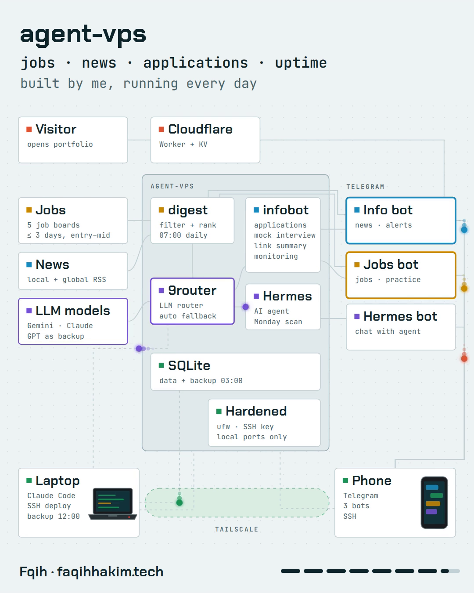

# agent-vps

A 2 GB VPS that works as my personal assistant. Every morning it finds fresh
entry-to-mid level jobs and news, and through the day it tracks my job
applications, drills me on interview questions, and watches the server.



48-second walkthrough: [docs/agent-vps.mp4](docs/agent-vps.mp4)

## Why

Job digests I subscribed to were long and full of postings that had closed
weeks earlier. This one only sends jobs posted in the last 3 days that match
my level and location, and it never sends the same job twice.

The main design rule: **deterministic work happens in code, the LLM only does
the part that needs judgment.** Date, seniority and location filters,
deduplication and dead-link checks are plain Python. The model only ranks the
survivors against my CV and writes one line per pick.

## What it does

| Part | When | What |
|---|---|---|
| `digest.py` | daily 07:00 | Pulls jobs (Kalibrr, Jobstreet, LinkedIn, RemoteOK, We Work Remotely) and news (RSS), filters, ranks top 5 jobs and top 3 news, sends them to two Telegram bots |
| `digest.py --weekly` | Monday 07:30 | Deeper research scan through the Hermes agent with a stronger model |
| `infobot.py` | always on | Jobs bot and info bot (see below), scheduler, monitoring |
| `backup.py` | daily 03:00 | SQLite online backup, gzip, keeps 7 days |
| `worker/` | per request | Cloudflare Worker that sends a Telegram alert for each new portfolio visitor (IP masked, one alert per visitor per day) |

**Jobs bot**
- application tracker: saved, applied, interview, offer, rejected; follow-up reminder after 7 days
- company and interview brief generated when a job moves to applied or interview
- daily mock interview question over 9 topics, graded 0-10 by the LLM, weak answers repeat sooner (spaced repetition)
- weekly recap

**Info bot**
- morning news
- send any link, get a 3-point summary, weekly reading recap
- uptime checks every 5 minutes (alert after 2 failures, message on recovery), disk, RAM, containers, failed systemd units
- alert on every SSH login, domain expiry check, alert if the daily digest did not arrive

All bots check both sender and chat id against one owner id and ignore
everyone else.

## Stack

- Python 3.8+, standard library only, SQLite (WAL) for state
- [9router](https://github.com/decolua/9router), a self-hosted OpenAI-compatible router in front of Gemini, Claude and GPT with fallback
- [Hermes agent](https://github.com/NousResearch/hermes-agent) for the weekly research and a personal chat assistant
- systemd services and timers, Docker for 9router
- Tailscale for laptop and phone access; ufw allows only SSH (key-only) and web, Docker ports are bound to 127.0.0.1
- Cloudflare Workers + KV for the visitor notifier

## Layout

```
digest.py      daily/weekly digest, LLM client with fallback, Telegram send
sources.py     job APIs and RSS fetchers (retry once on network errors)
filters.py     pure filtering, dedup and formatting functions
infobot.py     both bots, owner check, scheduler
tracker.py     job application tracker
practice.py    interview practice with spaced repetition
brief.py       company / interview brief
readlater.py   link summaries
monitor.py     uptime, system, SSH and domain checks
backup.py      SQLite backups
tg.py          minimal Telegram Bot API client
systemd/       unit files (paths assume user "agent")
worker/        Cloudflare Worker for portfolio visitor alerts
setup-vps.sh   Tailscale, localhost binds, ufw
```

## Setup

1. Run 9router (or any OpenAI-compatible endpoint) and point the `model:`
   block of `~/.hermes/config.yaml` at it (`base_url`, `api_key`, `default`).
2. Create two Telegram bots with @BotFather and copy `.env.example` to
   `~/.hermes/hermes.env`.
3. Try it: `python3 digest.py --dry-run` prints the digest without sending.
4. Copy `systemd/*` to `/etc/systemd/system/`, adjust the user and paths, then
   `sudo systemctl enable --now hermes-digest.timer hermes-weekly.timer db-backup.timer infobot`.
5. Optional: `bash setup-vps.sh` for Tailscale and the firewall.

The CV profile used for ranking lives in `PROFILE` in `digest.py`; change it
to your own.

## Tests

```
python3 -m unittest test_filters test_infobot
node --test worker/src/index.test.mjs
```

## License

MIT
